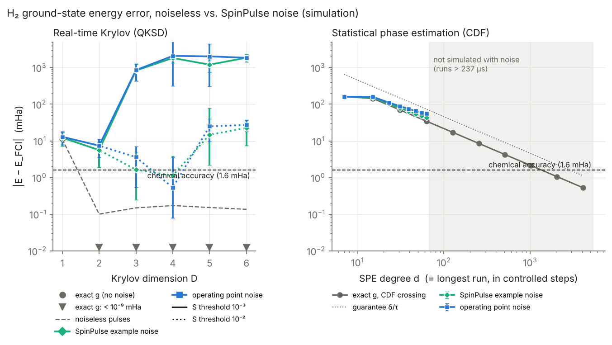
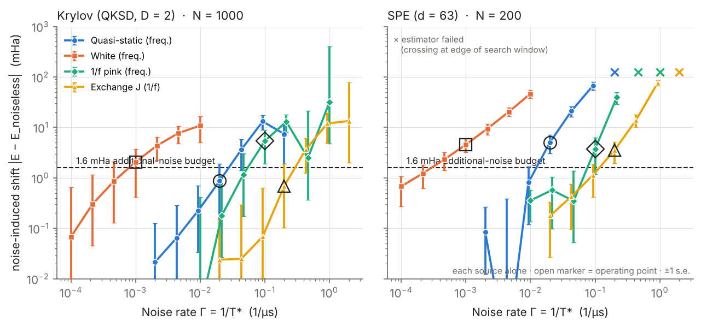
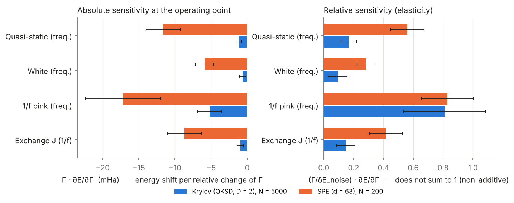

# Quantum Krylov vs. phase estimation on simulated silicon spin qubits

For H₂, I estimated the ground-state energy with a real-time quantum Krylov method and with statistical phase estimation (SPE). I ran both at pulse level on **SpinPulse**, Quobly's open-source simulator of spin-qubit processors, measured how each spin-qubit noise source degrades their accuracy, and estimated what each costs in circuit depth and shots. H₂ is tapered exactly to **one qubit, plus one ancilla: two spin qubits in total**.

> Everything here is **simulation**. No Quobly hardware data is used, and the project is not affiliated with or endorsed by Quobly.

**TL;DR**

- Under SpinPulse noise at a realistic operating point, real-time Krylov (D = 2) estimates the H₂ ground-state energy to −6.3 ± 1.7 mHa (about 4× chemical accuracy) from 8 µs circuits. Statistical phase estimation at d = 63 (237 µs circuits) is resolution-limited, at −55 ± 4 mHa.
- 1/f qubit-frequency noise has the largest effect on both. SPE's long circuits are also strongly affected by quasi-static, exchange and white noise: roughly an order of magnitude more than Krylov in absolute terms.
- In an ideal-gate estimate at 1.6 mHa, Krylov needs 8 µs circuits but 1.7 × 10⁵ shots per circuit, while SPE needs only about 5,300 shots but circuits of up to 7.2 ms (≈720× T₂*). Total QPU time is similar (4 s vs 7 s).



*Fig. 1. Energy error without noise (grey) and under SpinPulse noise (colour). Grey triangles mark Krylov dimensions where the exact-g error is below 10⁻⁹ mHa, i.e. below the axis. Left: Krylov at two relative S thresholds (the retained rank is listed in the text). Right: SPE with the continuous CDF-crossing readout; the dotted line is the δ/τ resolution guarantee.*

## Results

The headline comparison is Krylov at D = 2 against SPE at d = 63. The sweeps and the SPE results share one set of seeded noise realizations (seed 2026). The Krylov sensitivities and headline operating-point values use an independent, larger set (N = 5000, seed 2027); Fig. 1's Krylov curves and the Krylov sweeps use the N = 1000 set (seed 2026), which gives a consistent −7.4 ± 3.8 mHa at D = 2. Errors are E − E_FCI ± one jackknife standard error. All results use SpinPulse with the qubit-ordering correction described under Implementation notes.

- **Without noise, Krylov is exact at D = 2, while SPE is resolution-limited.** From HF, the Krylov space of H₂ is 2-dimensional, so D = 2 is exact; noiseless SpinPulse pulses add +0.10 mHa. SPE's error shrinks as 1/d: −34.4 mHa at d = 63. The exact estimator reaches 1.6 mHa near d ≈ 1375; the resource estimate below uses d = 1919 to leave margin for shot noise (Fig. 1).
- **With noise, Krylov misses chemical accuracy.** At the operating point it gives −6.3 ± 1.7 mHa (N = 5000), and −5.0 ± 1.3 mHa with SpinPulse's calibrated example noise alone. SPE at d = 63 gives −55.1 ± 4.2 mHa: its −34 mHa resolution bias plus a −20.7 ± 4.2 mHa noise-induced shift. Around the operating point, every source shifts both estimates downward. At much higher noise, the Krylov D = 2 estimate can overshoot above FCI (1/f noise at 3–10× the operating rate).
- **1/f qubit-frequency noise has the largest effect on both, but the profiles differ.** For Krylov, the noise-induced shift responds most strongly to 1/f noise: elasticity 0.81 ± 0.27, so a 10 % change of the 1/f rate changes the shift by about 8 %. The other three are 0.09–0.17. SPE's elasticities are spread out: 0.83 ± 0.17 (1/f), 0.56 ± 0.11 (quasi-static), 0.42 ± 0.11 (exchange) and 0.28 ± 0.06 (white). In absolute terms (Γ·∂E/∂Γ, Fig. 3), SPE is about 3× more sensitive than Krylov to 1/f noise and roughly 10× more to quasi-static, white and exchange noise; Krylov's small values carry large relative errors. SPE's runs last 237 µs against 8 µs, so slow-noise sources that barely matter for Krylov become first-order. The elasticities don't sum to 1 because the sources combine non-additively (and the shift grows faster than linearly in most rates).
- **Depth and shots trade off.** In an ideal-gate estimate (exact g, shot noise only), Krylov needs 4 circuits of at most 8.1 µs (4 RZZ) and 1.70 × 10⁵ shots per circuit. SPE needs 1920 circuits of up to 7.2 ms (3838 RZZ) but only 5,288 shots in total. Both budgets are validated directly with 20,000 Monte Carlo trials (table below). The summed run time is similar (4.2 s vs 7.4 s of QPU time). This matches [3]'s conclusion that Krylov reaches a given precision at much lower depth in exchange for many more shots. SPE's longest runs are about 720× T₂* (10 µs). That is a warning about depth, not a prediction of failure: echoes and the noise spectrum matter, and noisy SPE beyond d = 63 was not simulated.
- **Krylov beyond D = 2 is fragile under noise, and the result depends on the S threshold.** HF has only 1.2 % excited-state weight, so even the ideal D = 2 overlap matrix has a second eigenvalue of only 0.0146 (ratio 0.0073 to the largest). A relative threshold of 10⁻² would discard that physical direction of the ideal matrix, so thresholds must be read together with the retained rank. With a threshold of 10⁻³, D ≥ 3 retains 3–5 directions and produces spurious eigenvalues (errors of 0.8–2 Ha). With 10⁻², D = 3–4 retain only rank 2 and agree with D = 2 within error bars. Once a third direction is retained (D ≥ 5), the error grows again: −25 ± 15 and −27 ± 9 mHa at the operating point (Fig. 1).

**Ideal-gate resource estimate (exact g, shot noise only)**, at an RMSE of 1.6 mHa:

| Algorithm | Circuits | Longest run | RZZ in longest run | Shots | Validated RMSE (20,000 trials) | Trials with \|error\| > 10 mHa | Controlled steps, all shots | QPU time |
|---|---|---|---|---|---|---|---|---|
| Krylov, D = 2 | 4 | 8.1 µs (2 steps) | 4 | 6.8 × 10⁵ (1.70 × 10⁵ per circuit) | 1.54 mHa | 0 / 20,000 | 1.0 × 10⁶ | 4.2 s |
| SPE, d = 1919 | 1920 | 7.2 ms (1919 steps) | 3838 | 5,288 | 1.34 mHa | 1 / 20,000 | 2.0 × 10⁶ | 7.4 s |

QPU time is the sum of run durations over all shots, without reset or readout. Each step is 3.76 µs, and RZZ counts are SpinPulse's echoed halves. A coarse search with a few hundred trials first underestimated the SPE budget (about 4,100 shots gave an RMSE of 3.8 mHa). The CDF estimator takes the *first* crossing, so rare spurious early crossings (0.16 % of trials above 10 mHa) dominate the RMSE. Hence the direct validation with many trials.



*Fig. 2. Noise-induced shift |E − E_noiseless pulses| with each source alone. The dashed line is a 1.6 mHa additional-noise budget, not chemical accuracy relative to FCI: SPE's baseline is already −34 mHa. × marks configurations where the SPE estimator failed (no interior CDF crossing). The highest exchange-noise points go beyond the small-noise regime of the linearized J(1 + η) model (1 + η < 0 occurs at 10× the operating rate), so treat them as a numerical stress test.*

**Single-source budgets (rough central-value estimates).** For Krylov, each source alone keeps |E − E_FCI| ≤ 1.6 mHa up to roughly T₂*(1/f) ≥ 18 µs, T_J* ≥ 3.3 µs, T₂*(quasi-static) ≥ 35 µs and T₂*(white) ≥ 1.2 ms. These use the error relative to FCI, while Fig. 2 shows the shift relative to the noiseless pulses, and their uncertainty is comparable to 1.6 mHa. The operating point (10, 5, 50 and 1000 µs) meets the exchange and quasi-static values but not the 1/f and white ones. For SPE at d = 63 no single-source budget exists, because its resolution bias alone exceeds 1.6 mHa.



*Fig. 3. Left: absolute sensitivity Γ·∂E/∂Γ, the energy shift per relative change of each noise rate. Right: elasticity (Γ/δE_noise)·∂E/∂Γ, normalized by each algorithm's noise-induced shift. Central differences with a 10 % step and common random numbers; N = 5000 (Krylov) and N = 200 (SPE).*

**Scope.** HF overlap 98.8 % and a 2-dimensional Krylov space make this a best case for Krylov. The comparison is about these implementations on this model, not a general ranking of the two algorithm families.

## Method

### One quantum primitive, two estimators

Both algorithms use the same circuits: Hadamard tests of

  g(kτ) = ⟨HF| e^{−iH′kτ} |HF⟩,  k = 0, 1, …, K,

with one ancilla (⟨X_a⟩ = Re g, ⟨Y_a⟩ = Im g). Here H′ = H − c₀I, and the identity coefficient c₀ is added back classically. τ = π/(3λ) with λ the Pauli 1-norm of H′, so that τ|E′| < π/3 without knowing the spectrum.

- **Krylov (QKSD).** Basis |ψ_k⟩ = U^k|HF⟩, U = e^{−iH′τ}. The overlap matrix S_jk = g((k−j)τ) and the matrix T_jk = ⟨ψ_j|U|ψ_k⟩ = g((k−j+1)τ) are Toeplitz, so they come from the same g data. I solve the unitary pencil T v = μ S v after discarding eigenvectors of S below a relative threshold, as [3] does, and read energies from the eigenphases. This is the "KDM U" formulation of Cortes & Gray, which coincides with Klymko et al. [5, 6]. It needs no measurement of H.
- **Statistical phase estimation (SPE).** This follows [3] and Lin & Tong [7]. The spectral CDF of |HF⟩ is approximated by a Heaviside step smoothed with a Gaussian (a scaled error function) and truncated to odd Fourier modes j ≤ d:

  C̃(x) = ½ + Σ_{j odd ≤ d} (2/πj) e^{−j²σ²/2} Im[e^{ijx} g(jτ)].

  σ and the resolution δ follow the standard guarantee for this error-function construction (ε = η/8, η = p₀,min/2 with p₀,min = 0.5), checked numerically in the tested regime. The ground energy comes from the binary search used in [3] (after Lin & Tong), with threshold 3η/4 and shifts of 2δ/3. d is the longest circuit, in controlled steps.

**Difference from [3].** [3] obtains Chebyshev moments ⟨T_k(H)⟩ from qubitized walk operators and does not model circuit noise. A qubitized block encoding of H₂ is far too deep to simulate under realistic spin-qubit noise. I therefore use the real-time primitive, which [3] lists as the original SPE formulation and a standard QKSD variant. The estimators (CDF + binary search, thresholded generalized eigenproblem) are [3]'s.

**Continuous SPE readout.** The binary search is a quantizer: under small changes of g its output stays fixed or jumps by about δ, so finite differences of it are meaningless. For the noise sweeps and sensitivities I use the threshold crossing x_c, the smallest x with C̃(x) = 3η/4. This is the point the binary search brackets. It stays within δ of the bisection result and depends smoothly on g. Both readouts are stored in `results.json`. When C̃ never crosses the level inside the search window, the estimate is pinned at the window edge; this is flagged as a failure and counted.

### System and circuits

| Step | Tool / choice | Code |
|---|---|---|
| H₂ / STO-3G at 0.735 Å, Jordan–Wigner (4 qubits, 15 Pauli terms) | OpenFermion + PySCF | `src/krylov_qpe/hamiltonian.py` |
| Z₂ tapering with stabilizers (+Z₀Z₁, −Z₀Z₂, −Z₀Z₃) → 1 qubit: H = c₀I + g_z Z + g_x X; Hartree–Fock = \|0⟩ | OpenFermion `taper_off_qubits` | same |
| Controlled e^{−iH′τ}: one RZZ + single-qubit rotations (exact, no Trotter error for 1 qubit) | Qiskit | `evolution.py` |
| Ancilla + system = 2 neighbouring spin qubits | | |
| Transpile, compile to Gaussian pulses, integrate under classical noise | **SpinPulse 1.1.3** | `noisy.py` |
| Estimators | NumPy / SciPy | `krylov.py`, `phase_est.py` |
| Shots and depth at chemical accuracy | Monte Carlo | `resources.py` |
| Sweeps, sensitivities (common random numbers, jackknife errors) | | `sensitivity.py` |

**No fast-forwarding.** For a 1-qubit Hamiltonian, U^k could be compiled as one controlled rotation of angle kθ. A many-body Hamiltonian cannot, so U^k is applied as k separate controlled steps, and circuit depth grows linearly with evolution time as it would with Trotterized dynamics. One step compiles to 2 echoed RZZ halves plus single-qubit rotations: 3.76 µs, gate fidelity 0.99999 without noise.

**Krylov space of H₂.** Starting from Hartree–Fock, time evolution only reaches two determinants (HF and the doubly excited one), with or without tapering. The real-time Krylov space is therefore exactly 2-dimensional, and noiseless QKSD is exact at D = 2. This is a best case for Krylov; a larger system (LiH active space, Hubbard chain) is the natural next test.

### Noise model and statistics

Hardware model (1 ns time step, 1 µs X and ZZ gates, 0.1 µs Z gates) and two of the noise values come from SpinPulse's *ParametrizingfromQPUSpecs* example. Noise rates are Γ = 1/T* (1/µs).

| Source | SpinPulse model | Operating point | Origin |
|---|---|---|---|
| 1/f (pink) qubit-frequency noise | `NoiseType.PINK`, `T2S` | T₂* = 10 µs | SpinPulse example (F₁ > 0.9995 there) |
| Exchange (J) noise, 1/f | `TJS` | T_J* = 5 µs | SpinPulse example (F₂ ≈ 0.994 there) |
| Quasi-static frequency noise | `NoiseType.QUASISTATIC` | T₂* = 50 µs | **assumption** (residual shot-to-shot miscalibration) |
| White frequency noise | `NoiseType.WHITE` | T₂* = 1 ms | **assumption** (weak Markovian floor) |

The 1/f traces use one fixed 262 µs segment (2¹⁸ ns, 3.8 kHz low-frequency cutoff) for every run, so both algorithms see the same spectrum; a run longer than the segment raises an error.

- **Trajectories.** Each noise realization integrates prep and steps on consecutive slices of one continuous seeded noise trace and reads g after every step. Each prefix has exactly the noise statistics of a separate run of that length. Expectation values are exact per realization (no shot noise), and the measured quantity is their average over realizations.
- **Combining sources.** Several sources at once are summed and passed to SpinPulse's `PulseCircuit.attach_time_traces` in a small container; a test checks that it reproduces SpinPulse's own `ExperimentalEnvironment` exactly.
- **Common random numbers.** Every trace is generated by SpinPulse at a reference rate and rescaled. This equals regenerating it with the same seed (tested), so all noise settings share the same realizations.
- **Error bars** are delete-one-block jackknife standard errors (20 blocks), because the estimators are nonlinear functions of averaged data.

**Sensitivities.** At the operating point, with relative step h = 10 %:

  S_j = ∂E/∂Γ_j ≈ [E(Γ_j(1+h)) − E(Γ_j(1−h))]/(2hΓ_j),  ε_j = Γ_j S_j / (E(Γ₀) − E_noiseless).

I normalize ε_j by the *noise-induced* shift rather than the total error, because SPE's total error also contains its resolution bias (≈1/d), which no noise source controls. Γ_j S_j (in mHa) is directly comparable between the two algorithms.

## Implementation notes

- **SpinPulse qubit-ordering correction.** In SpinPulse 1.1.3, `PulseLayer.to_circuit` embeds each operand's local terms (detuning ramps, frequency noise) on swapped tensor factors during two-qubit layers. Qiskit is little-endian, so qubit 0's terms act on qubit 1 and vice versa. `spinpulse_patch.py` replaces that method by a copy in which only the two `einsum` strings are exchanged. The patch is applied at import and in every worker process; `--no-spinpulse-patch` reproduces SpinPulse as released. With the patch, the noiseless pulse error of the Krylov circuit drops from 0.71 to 0.10 mHa. The controlled step's gate fidelity is unchanged (0.999993): during exchange the two operands carry detuning ramps of equal size and opposite sign, so the swap mirrors the residual error, keeping its size but changing its direction (the step unitaries differ by 6 × 10⁻³). Frequency noise, by contrast, was applied to the wrong qubit. `tests/test_noisy.py` has an asymmetric test (a frequency offset on qubit 0 during an exchange layer) that fails without the patch. Reported upstream: issue in preparation (link to be added).

- **Deterministic transpilation.** In SpinPulse 1.1.3, `HardwareSpecs` uses an unseeded Qiskit `GenericBackendV2`, whose random error rates steer single-qubit gate decomposition, so the same circuit compiles differently on each run. `make_hardware_specs` rebuilds the two pass managers exactly as SpinPulse does, on a seeded backend.
- **Exact accelerator (optional).** SpinPulse's pulse integration (`utils.propagate`) computes one `scipy.linalg.expm` per nanosecond slice. `fast_propagate.py` computes the same product with batched eigendecompositions and a pairwise product (agreement ≈10⁻¹⁴, tested on full noisy trajectories). It is on by default; `--no-fast-propagate` uses SpinPulse's own function.

## Reproduce

```bash
pip install -e ".[dev]"             # or: pip install -r requirements.txt; Python ≥ 3.11
pytest                              # 22 tests, ~15 s
python scripts/run_all.py --quick   # smoke run, ~15 min
python scripts/run_all.py --max-minutes 100   # full run, ~3 h on 2 cores; rerun until it completes
jupyter notebook notebooks/demo.ipynb   # walk-through, ~1 min (needs `pip install notebook`)
```

`--quick` regenerates all figures with few realizations in about 15 minutes. `run_all.py` writes `results/results.json` (all numbers, seeds, versions, patch status) and regenerates every figure through `scripts/make_figures.py`.

Noisy samples are cached in blocks under `results/cache/`, so an interrupted run (or one stopped by `--max-minutes`) resumes where it stopped and gives identical results (tested). Cache keys include package versions, the 1/f segment, the patch status, the hardware specs and the compiled circuits; still, **delete `results/cache/` after changing any parameter**. The full run has four stages:

1. resources and budget validation (~10 min);
2. Krylov sweeps and sensitivities (N = 1000, ~45 min);
3. SPE (N = 200, ~95 min);
4. Krylov sensitivities at high statistics (N = 5000, ~25 min).

## Tests

- H₂ FCI matches PySCF and the literature value; the tapered spectrum equals the JW spectrum in the HF symmetry sector (OpenFermion's matrix); HF is a tapered basis state.
- The controlled step equals controlled-expm(−iH′τ) (SciPy); circuit-level g(kτ) equals the exact g; τ avoids aliasing; U^k is not fast-forwarded.
- Krylov is exact for D ≥ 2 and S has a null direction at D = 3; the SPE CDF is a smoothed step of height p₀; SPE stays within its δ guarantee and reaches chemical accuracy at large d.
- Noiseless SpinPulse pulses reproduce g to 2×10⁻³; the accelerated integrator equals SpinPulse's; the trace container equals SpinPulse's environment; rescaled traces equal regenerated ones (quasi-static, white, pink); zero noise reproduces the noiseless pulses; runs are bit-for-bit reproducible, also when split into blocks.
- A frequency offset on qubit 0 during an exchange layer acts on qubit 0 with the SpinPulse patch and on qubit 1 without it; the patch reaches joblib worker processes.
- The jackknife reproduces the standard error of a mean; the sensitivity code recovers exact derivatives of a known model, and common random numbers cancel shared noise.

## Limitations

- **Toy system with a 2-dimensional Krylov space.** That favours Krylov strongly. SPE's cost (depth ∝ 1/δ) does not depend on this.
- **No shot noise in the noisy runs.** Noise effects are isolated from sampling; shots are treated separately and noiselessly in the resource table.
- **Two of the four operating-point values are my assumptions** (quasi-static and white). Single-source sweeps do not depend on them; the sensitivities do.
- **Noise model scope.** Only SpinPulse's classical noise: no T₁, readout error, leakage or crosstalk. The final ancilla basis change (one single-qubit gate) is not simulated; ⟨X_a⟩ and ⟨Y_a⟩ are read from the state.
- **SPE at d = 63 is far from chemical accuracy even without noise** (the exact estimator needs d ≈ 1375). SPE beyond d = 63 was not simulated with noise.
- **Not [3]'s primitive, nor its SPE construction.** Real-time evolution replaces qubitized walk operators (see Method). The CDF uses a Gaussian-smoothed step, not [3]'s Chebyshev/Bessel construction, so [3]'s tighter guarantees don't transfer automatically.
- **1/f cutoff and calibration.** The fixed 2¹⁸ ns segment (≈3.8 kHz cutoff) differs from SpinPulse's tutorial (2²⁰ ns). For 1/f noise, T₂* is not a universal decay constant (it depends on the cutoff and the time window; SpinPulse paper, §3.4.2), so reusing the tutorial's T₂* and T_J* values does not reproduce its gate-fidelity calibration exactly.
- **Exchange-noise stress test.** The highest exchange-noise sweep points go beyond the small-noise regime of the linearized J(1 + η) model.
- **Numerical settings not varied:** finite-difference step (fixed at 10 %), SpinPulse's 1 ns integration step, and the number of realizations of the single-source sweeps.

## Next steps

- A system with a non-trivial Krylov space (LiH active space, small Hubbard chain), and a variational subspace method such as Akande et al. [8] as a third point of comparison.
- A pink-noise cutoff comparison (2¹⁸ vs 2²⁰ ns), and noisy SPE at larger d with dynamical decoupling.

## Relation to my Quandela work

| Quandela (Belisama) | This demo |
|---|---|
| Photonic QPU (Belenos), linear optics | Silicon spin qubits (SpinPulse) |
| Noise: loss, distinguishability, g², dark counts, phase drift | Noise: quasi-static, white, 1/f, exchange (J) |
| Benchmarks: TVD, genuine indistinguishability | Benchmarks: ground-state energy error, depth and shot cost |
| Sensitivity matrix ∂(benchmark)/∂(parameter) | ∂E/∂Γ for two algorithms |

Author: Amalia Tsitsekli (M2 Quantum Engineering, ENS–PSL).
